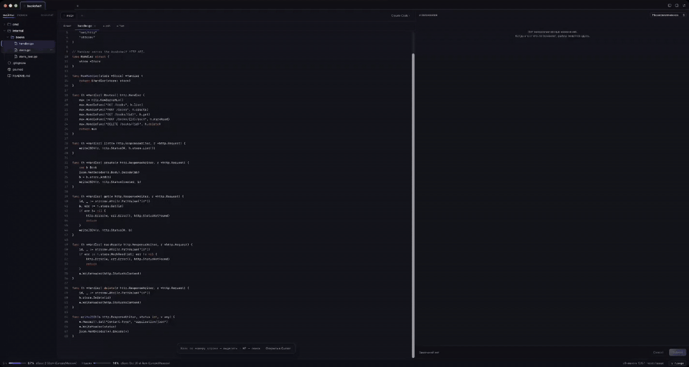

# ☥ Ankh

Рабочее место для CLI-агентов на macOS. Проекты открыты вкладками, агент работает в настоящем терминале, а его изменения видны справа — с построчным ревью, как в merge request. Замечания из ревью уходят агенту одним промптом.

Ankh не заменяет агента и не ходит в сеть сам: он запускает ваш `claude` (или Codex CLI, Gemini CLI, OpenCode) через ваш login-shell. Ваши настройки, прокси, MCP-серверы и ключи работают так же, как в обычном терминале. Регистрация и аккаунт не нужны.



## Возможности

**Проекты и сессии**

- Проекты — вкладками сверху. Точка у вкладки показывает статус агента: работает или ждёт ввода.
- В проекте может быть несколько сессий. Основная работает в папке проекта, остальные — в отдельных git worktree (`~/.ankh/worktrees/<проект>/<ветка>`), у каждой свой агент.
- Для новых worktree можно задать скрипт подготовки, например `cp "$ANKH_PROJECT/.env" . && npm ci`.
- Счётчик на иконке в Dock показывает, сколько агентов ждут ввода.

**Агент**

- Настоящий терминал (PTY): работают TUI, цвета, вставка, мышь. Рядом можно открыть обычный `zsh` в папке сессии.
- Пресеты: Claude Code, Codex CLI, Gemini CLI, OpenCode. Агента можно сменить для каждой сессии.
- Для Claude Code статусы точные (через хуки), разговор продолжается после перезапуска (`--continue`), а внизу видны заполненность контекста и лимиты: 5-часовое окно и неделя.
- Подсказки над терминалом: `/compact`, когда контекст заполнен на 60–80%, и `/clear` после коммита задачи или смены ветки. Кнопка в подсказке сама выполняет команду.
- **tmux** (включается в настройках): агент работает в отдельном сервере `tmux -L ankh` и переживает перезапуск Ankh вместе с выводом терминала.
- **Чат (ACP)**, экспериментально: вкладка «+ Чат» запускает агента через [Agent Client Protocol](https://agentclientprotocol.com). Сообщения, план, вызовы инструментов и запросы разрешений показываются отдельными блоками.

**Файлы и поиск** (только чтение)

- Дерево файлов с git-статусами. Правый клик → **Edit…** → промпт вида `@path — текст` уходит агенту.
- Превью файла с подсветкой синтаксиса. Клик по номеру строки выделяет строку, Shift+клик — диапазон; затем **Edit…**.
- **⌘P** — быстрый поиск файла по имени (нечёткий: `hndlr` находит `handler.go`).
- **⇧⌘F** — поиск по всем файлам через `git grep` с учётом .gitignore: регистр, слово целиком, регулярные выражения, фильтр по файлам.
- **⌘F** — поиск в открытом файле с подсветкой совпадений.
- Изменения на диске Ankh видит сразу, через FSEvents.

**Изменения и ревью**

- Режимы: незакоммиченное, вся ветка против базовой (develop / main / master), последний коммит.
- Клик в код или **+** у строки — комментарий (колонка запоминается), Shift+клик — диапазон строк.
- **Submit** отправляет все замечания одним промптом:

  ```
  Исправь замечания по ревью (2):
  internal/order/handler.go:137:10 - переименуй переменную tmp в total
  internal/order/handler.go:142-150 - добавь обработку ошибки
  ```

- Замечание идёт за своей строкой: если код выше сдвинулся, оно переезжает вместе с ним. Пометка «строка изменилась» появляется, только когда строки больше нет.
- Индекс и коммит прямо в панели: галочка у файла — stage/unstage, ↺ — откатить файл, Stage all / Unstage all / Откатить всё, поле сообщения и **Commit** (⌘Enter).

**GitLab** (через ваш [`glab`](https://gitlab.com/gitlab-org/cli))

- Статус MR текущей ветки и pipeline.
- «Создать MR»: push и `glab mr create --fill`.
- «В MR»: опубликовать черновики замечаний обсуждениями на строках.
- «Забрать N»: перенести открытые обсуждения MR в черновики, чтобы отдать их агенту через Submit.

## Установка

Нужна macOS 11 или новее (Apple Silicon или Intel) и установленный агент — например, [Claude Code](https://docs.claude.com/en/docs/claude-code).

```bash
curl -fsSL https://raw.githubusercontent.com/isaevfeed/ankh-ide/main/install.sh | sh
```

Скрипт скачивает последний релиз с GitHub, проверяет контрольную сумму и кладёт `Ankh.app` в `/Applications` (если туда нельзя писать — в `~/Applications`). Запущенный Ankh он закроет. Той же командой Ankh обновляется.

Конкретная версия:

```bash
curl -fsSL https://raw.githubusercontent.com/isaevfeed/ankh-ide/main/install.sh | ANKH_VERSION=v0.1.0 sh
```

Скрипт короткий — прочитайте его перед запуском: [install.sh](install.sh).

### Почему не обычный .dmg

Ankh пока не подписан сертификатом Apple Developer ID и не нотаризован: сборка подписана ad hoc. Файлы, скачанные браузером, macOS помечает как загруженные из интернета, и Gatekeeper не даст открыть такое приложение. Файлы, скачанные через `curl`, такой пометки не получают, поэтому установка скриптом проходит без предупреждений.

Если вы всё же скачали архив из [Releases](https://github.com/isaevfeed/ankh-ide/releases) браузером, после распаковки снимите пометку:

```bash
xattr -dr com.apple.quarantine /Applications/Ankh.app
```

или откройте приложение один раз и разрешите его в «Системные настройки → Конфиденциальность и безопасность → Всё равно открыть».

### Из исходников

Нужны Go 1.25+, Node 20+ и Xcode Command Line Tools (`xcode-select --install`).

```bash
git clone https://github.com/isaevfeed/ankh-ide.git
cd ankh-ide
make setup     # зависимости Go и npm, один раз
make install   # собрать Ankh.app и положить в /Applications
```

### Дополнительно

- `brew install tmux` — чтобы агенты переживали перезапуск Ankh.
- `brew install glab && glab auth login` — для работы с GitLab MR.

### Удаление

```bash
rm -rf /Applications/Ankh.app "$HOME/Library/Application Support/Ankh" "$HOME/.ankh"
tmux -L ankh kill-server 2>/dev/null || true
```

`~/.ankh` содержит worktree созданных сессий — проверьте, что в них не осталось нужных изменений.

## Начало работы

1. Откройте Ankh и нажмите **Открыть проект…** — выберите папку с git-репозиторием.
2. Агент запустится в центре. Пишите ему как обычно.
3. Когда агент что-то поменяет, файлы появятся справа. Кликните в строку диффа, оставьте замечание и нажмите **Submit**.
4. Для параллельной задачи нажмите **+** у вкладок сессий: Ankh создаст worktree с новой веткой и запустит в нём отдельного агента.

## Горячие клавиши

| Клавиши | Действие |
|---|---|
| ⌘P | быстрый поиск файла |
| ⇧⌘F | поиск по всем файлам |
| ⌘F, ⌘G / ⇧⌘G | поиск в открытом файле, следующее / предыдущее |
| ⌘1…9 | переключить проект |
| ⌘B / ⌥⌘B | скрыть файлы / изменения |
| ⌘, | настройки |
| ⌘Enter | сохранить комментарий / закоммитить |
| Shift+клик по + | комментарий к диапазону строк |

В быстром поиске: Enter открывает превью, ⌘Enter — Edit…, ⇧Enter вставляет `@путь` в поле ввода агента.

## Настройки

Кнопка с ползунками в правом верхнем углу (⌘,):

- агент по умолчанию для новых проектов и сессий;
- отправлять ли Edit и Submit сразу или только вставлять текст в поле ввода;
- показывать ли файлы из .gitignore;
- агенты в tmux;
- команда чата (ACP) для выбранного агента;
- редактор для «Открыть в…» (Cursor, Zed, Visual Studio Code — любое приложение);
- скрипт подготовки worktree для текущего проекта.

Состояние хранится в `~/Library/Application Support/Ankh/state.json`, журнал — в `ankh.log` там же.

## Как это устроено

Ankh — приложение на [Wails v3](https://v3alpha.wails.io): бэкенд на Go, интерфейс на React и xterm.js.

Агент запускается командой `$SHELL -l -i -c "exec claude …"`, поэтому подхватываются `PATH`, прокси и переменные из `.zprofile` и `.zshrc`, даже если Ankh открыт из Dock.

Статусы и лимиты Claude Code приходят без изменения ваших настроек: Ankh запускает `claude --settings ~/Library/Application\ Support/Ankh/claude-settings.json`. В этом файле только хуки `UserPromptSubmit`, `Stop`, `Notification`, `SessionStart` и `statusLine`; они вызывают сам бинарник Ankh (`ankh hook …`, `ankh statusline`), а тот передаёт данные в приложение через unix-сокет. Ваш собственный `statusLine` из `~/.claude/settings.json` продолжает работать: Ankh вызывает его и печатает его вывод.

Переменные в терминалах Ankh: `ANKH_SESSION`, `ANKH_SOCK`, `ANKH_PROJECT` (папка основного проекта — удобно для скрипта подготовки worktree).

```
main.go                 окно Wails, сервис, подкоманды hook и statusline
internal/app            сервис для интерфейса: проекты, сессии, терминалы, git, ревью, статусы
internal/term           PTY (creack/pty), вывод пачками по 16 мс, bracketed paste
internal/agent          пресеты агентов, настройки для Claude Code, tmux, unix-сокет
internal/gitx           вызовы git: статус, дифф, индекс, коммит, worktree
internal/diffparse      разбор unified diff
internal/review         промпт из замечаний, перенос замечаний за строкой
internal/fstree         дерево и чтение файлов внутри папки сессии
internal/fswatch        FSEvents (cgo, CoreServices)
internal/search         поиск по файлам (git grep или обход папки)
internal/glab           GitLab MR через glab
internal/acp            клиент Agent Client Protocol (JSON-RPC по stdio)
internal/state          state.json
cmd/devserver           тот же сервис по HTTP — для разработки интерфейса в браузере
frontend/               React + TypeScript + xterm.js
```

## Ограничения

- Только macOS.
- Редактирования нет: превью и поиск только для чтения, правки делает агент или ваш редактор.
- Статусы «работает / ждёт» точные для Claude Code. Для других агентов они определяются по активности вывода.
- Чат через ACP экспериментальный: для Claude Code он запускает `npx -y @agentclientprotocol/claude-agent-acp`, нужен Node.
- Сборка не подписана Developer ID и не нотаризована — см. «Почему не обычный .dmg».

## Участие

Баги и идеи — в [Issues](https://github.com/isaevfeed/ankh-ide/issues). Как собрать проект, запустить тесты и прислать изменения — в [CONTRIBUTING.md](CONTRIBUTING.md).

## Лицензия

[MIT](LICENSE)
